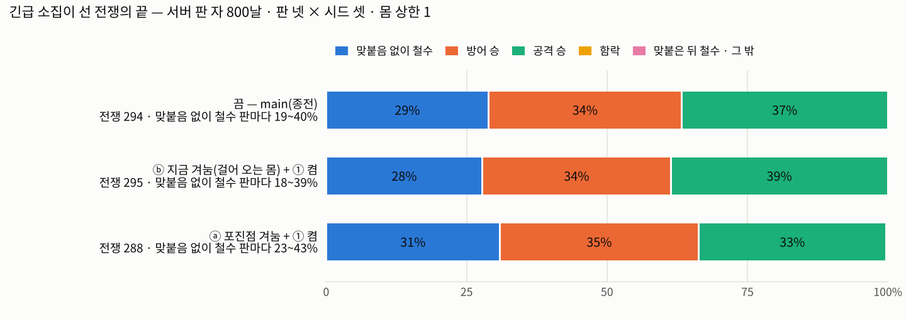

# 재민 질문 — 교전 없는 철수, 결함인가 의도인가 (T1060 ② · T1044 회부 1 · T1031 회부 3 · 2026-11-02 · 세션3)

**물음.** 농성 마을에 돌격 결단이 서면 그 마을 사람이 긴급 소집된다. 소집된 몸이 멀리(일터 · 들) 있으면 걸어 오는 동안 공격과 접촉 없이 대치가 서고(진척 시계 — 두 본대 간격이 몇 초 안 줄면 대치), 이튿날 공격이 물러난다(**맞붙음 없이 철수**).
이것이 결함인가(공격이 성문까지 가서 덜 모인 수비와 싸워야 한다), 의도인가(수비가 모이는 동안 공격이 성문을 못 넘고 물러나는 것이 맞다)?

판 자 갈래 둘을 돌려 근거만 냈다(판정 0): ⓑ = 지금 그대로(공격이 걸어 오는 수비 몸 = B 무게중심을 겨눈다) · ⓐ = 공격이 수비의 **포진점(회관 앞)**을 겨눈다(판 자 아이 env `T1060_ATK_AIM=1` — 제품 기본 무변). 두 갈래 다 ①(긴급 소집 대형의 재편 원점 = 포진점 · 이 카드의 고침) 켬 · 끔 갈래는 main 그대로.

| 갈래(판 넷 × 시드 셋 · [판마다 띠]) | 긴급 소집이 선 전쟁 | 맞붙음 없이 철수 | 방어 승 · 공격 승(전투) | 함락 | 사상 공 · 방 | 길이 가운데 · 가장 긴(날) | 접촉 — S1 100칸 밖 · S2 100칸 밖(소집 줄) | 접촉 0 대치 — 풀림 0 · 사거리 안 · 수비 먼 길 & 공격 성문 앞 · 수비 먼 길 & 공격 성문 밖 · 그 밖 | 전쟁 다: 맞붙음 없이 철수 · 방어 승 · 공격 승 · 함락 |
|---|---:|---|---|---:|---|---|---|---|---|
| 끔 — main(종전 · ① 없음) | 294 | **85/294(29%)** [판마다 19 ~ 40%] | 101 [19 ~ 33] · 108 [21 ~ 32] | 0 | 73 · 108 | 3 · 16 | 25/70(36%) · 11/28(39%) | 89 — 4 · 18 · 16 · 48 · 3 | **168/634(26%)** [판마다 20 ~ 33%] · 214 · 238 · 11 |
| ⓑ 지금 겨눔(걸어 오는 몸) · ① 켬 | 295 | **82/295(28%)** [판마다 18 ~ 39%] | 99 [15 ~ 33] · 114 [23 ~ 34] | 0 | 65 · 114 | 3 · 16 | 33/77(43%) · 13/32(41%) | 85 — 4 · 18 · 18 · 42 · 3 | **170/643(26%)** [판마다 21 ~ 33%] · 204 · 249 · 15 |
| ⓐ 포진점 겨눔 · ① 켬 | 288 | **89/288(31%)** [판마다 23 ~ 43%] | 102 [18 ~ 34] · 96 [16 ~ 36] | 0 | 72 · 96 | 3 · 17 | 26/81(32%) · 3/18(17%) | 91 — 3 · 13 · 27 · 44 · 4 | **185/637(29%)** [판마다 24 ~ 38%] · 216 · 220 · 10 |

(판 자 = T959 자 — 800날 · 3시드 · 몸 상한 1(소집 몸 = 하나) · 벽시계 · 하루 250ms. 맞붙음 없이 철수 = 정산 0 · 철수 글이 있는 전쟁. 함락 = 무저항 함락 + 무혈 항복. 접촉 0 대치의 꼴: 공격 몸 · 수비 몸 = 대치 앞 걸음의 맞선 두 몸 · 성문 앞 = 포진점 13칸 안 · 먼 길 = 포진점 50칸 밖.
전쟁 자 assaulthold*3(돌격 결단 그 자리 소집 150번 · 소집 몸이 회관 가까이): 끔 전투 141(공격 승 78 · 방어 승 63) · 긴급 소집 150(접촉 146) / ⓑ · ① 켬 전투 141(공격 승 78 · 방어 승 63) · 긴급 소집 150(접촉 147) / ⓐ · ① 켬 전투 140(공격 승 62 · 방어 승 78) · 긴급 소집 149(접촉 140).)

**'성문 앞에서 덜 모인 수비' 사례 셋** — 공격 몸이 성문 앞(포진점 13칸 안)에 섰는데 수비 몸은 아직 수백 칸 밖에서 걸어 오는 중 · 접촉 0 인 채 대치 → 이튿날 철수.
판 자에서 이 꼴의 대치는 ⓑ 18 · ⓐ 27(긴급 소집이 선 전쟁 · 판 넷 × 시드 셋). 아래는 ⓐ 에서 수비 몸이 가장 먼 셋(같은 두 마을 겹침 뺌) — ⓑ 에도 같은 꼴이 있다 (예: run-b~raid3 · 시드 1020 · 어촌15 → 어촌9 · 750날 — 공격 포진점 7.5칸 · 수비 466.6칸 · 맞붙음 없이 철수).

| 판 | 두 마을 · 날 | 소집 꼴 | 대치 순간 공격 몸 | 대치 순간 수비 몸 | 끝 |
|---|---|---|---|---|---|
| ⓐ 판~raid3 · 시드 7 · 전쟁 22 | 임업4 → 농촌16 · 602날 | 결단 그 자리(S1) | 공격 archer — 포진점 1칸 | 수비 slinger — 포진점 521.6칸(걸어 오는 중) | 대치(43.73초) → 맞붙음 없이 철수(604날) · 전투 0 · 사상 0·0 |
| ⓐ 판 · 시드 7 · 전쟁 31 | 임업6 → 어촌14 · 665날 | 결단 그 자리(S1) | 공격 archer — 포진점 1칸 | 수비 archer — 포진점 486.7칸(걸어 오는 중) | 대치(39.93초) → 맞붙음 없이 철수(667날) · 전투 0 · 사상 0·0 |
| ⓐ 판~raid2 · 시드 42 · 전쟁 7 | 어촌7 → 광산2 · 424날 | 결단 그 자리(S1) | 공격 dagger — 포진점 1칸 | 수비 slinger — 포진점 486.2칸(걸어 오는 중) | 대치(41.73초) → 맞붙음 없이 철수(426날) · 전투 0 · 사상 0·0 |

**읽기(판정 0 — 무엇을 고를지는 재민).**
* 맞붙음 없이 철수는 겨눔을 바꿔도(ⓐ) 줄지 않았다 — 같은 세계에서 선 같은 전쟁끼리 보면 ⓑ 에서 맞붙음 없이 철수한 전쟁 26 · 그중 ⓐ 에서도 맞붙음 없이 철수 25. 그 대치를 세운 것은 겨눔보다 **진척 시계**다: 수비 몸이 수백 칸 밖에서 길을 돌아 걸어 오는 동안 두 본대의 곧은 간격이 몇 초(`standoffSec` — 근접 교전 거리 13m ÷ 느린 편 행군 속도 · 5.9 ~ 8.7초) 동안 1m 이상 안 줄면 대치가 선다 — 공격이 걸어 오는 몸을 쫓든(ⓑ) 성문 앞에서 기다리든(ⓐ) 같다. 이튿날 결단은 헛 돌격 칸(T956)을 보고 돌격 줄을 뺀 표에서 철수를 고른다.
* ⓐ 는 맞붙은 전투를 방어 쪽으로 옮긴다(공격이 회관 앞 포진 대형으로 들어간다) — 소집 몸이 회관 가까운 전쟁 자에서 또렷하고(위 줄) 판 자에선 띠 안이다(표의 [ ]).
* 결함으로 보면 손댈 자리 후보(이 카드는 안 고친다): ㉠ 진척 시계(war-live — 두 본대 간격 대신 목표 쪽 진척도 진척으로) · ㉡ 돌격 결단 시점(긴급 소집이 모일 때까지 기다림) · ㉢ 겨눔(ⓐ — 판 자에선 효과 없음) · ㉣ 덜 모인 성문(공격 몸이 포진점에 닿았는데 수비 몸이 멀면 무저항 함락 — 지금 무저항 함락은 수비 대형이 아예 없을 때만). 의도로 보면 지금 그대로(ⓑ) 두고 회부를 닫는다.
* 곁 — 수비 몸이 왜 수백 칸 밖에 있나는 T1042(세션14 · `batch/no-clash-1031`)가 해부했다: 같은 철수 41 마디 중 25 가 "방어 몸 멀리"고 그중 21 은 앞서 제 마을이 친 마을의 큰집 안에 서 있던 몸이다(몸 자리 쪽 뿌리 — 겨눔 · 대치와 따로).
