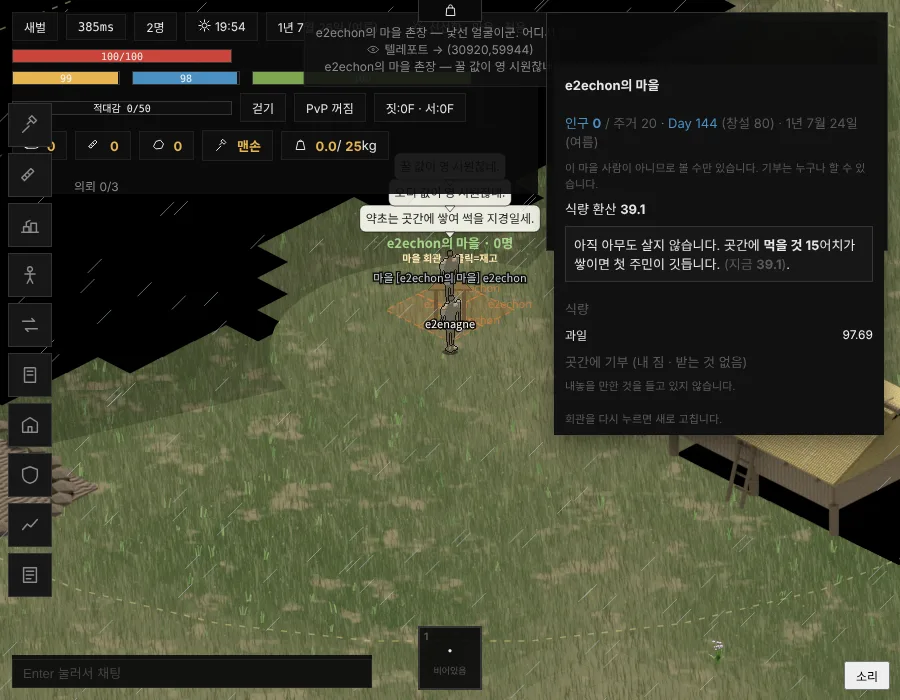

# T1132 보고 — 곳간 재고 보기 문 하나 (세션4 · 2026-11-04)

**한 줄 답:** 회관 패널의 보기 · 기부 문이 마을 화면과 같은 술어 하나(`villages.js _villageNear` · 260px)가 되었습니다. 그 마을 사람이 아니면 패널은 읽기 전용으로 열리고(이방인 받기 칸 없음 · 기부 칸 있음), 꺼내기는 서버 문이 여전히 촌장만 받습니다. 세계는 바뀌지 않았습니다(서버 기준선 같음 3/3).

- 손잡이 `T1132_HALL_VIEW` — 켬 기본(`!== '0'` · `=0` = 종전 글자).
- 베이스 = main `5cf77f79`(land1042 착지). 가지 `batch/hall-view-1104` = main + 이 카드 한 커밋 **[승인 대기 · T1132]**.
- 새 수 0 · 주사위 0 · 판정 0(★PM 11-03 문 12 ㄱ 그대로) · force 0 · 배포 0.

---

## §1 전 ↔ 후 문 표

| 문 | 종전 | 켬(T1132) |
|---|---|---|
| 마을 화면 「창고」(`village_view`) | 마을 한가운데 260px(`_villageNear`) · 가입 무관 | 그대로 |
| 회관 패널 **보기**(`village_inventory`) | 회관 200px + 그 마을 사람(`_furnaceCanUse`) — 남은 "볼 수 없습니다" | **마을 한가운데 260px(`_villageNear` 그 함수)** · 가입 무관 · 남 = 읽기 전용 |
| 회관 패널 **기부**(`village_deposit` 회관 갈래) | 회관 200px · 누구나(T769) | **패널 보기와 같은 260px 문** · 누구나 — `/기부` · 거래소 패널 기부(`villageWithdrawGate` = `_villageNear`)와도 같은 문 |
| 회관 패널 **이방인 받기** 칸(`inv.welcome`) | 패널을 연 사람 모두에게 실음(열 수 있는 사람 = 마을 사람) | 그 마을 사람에게만 실음 · 남에겐 안 실음. 스위치(`village_welcome`)는 그대로 촌장 · 200px |
| **꺼내기**(`village_withdraw`) | 서버 `Membership.withdrawChief` — 260px + 촌장 | 그대로(이 손잡이 밖). 회관 패널엔 원래 꺼내기 단추가 없다 — 거래소 패널 촌장 줄 하나 |
| 다른 시설(`d.vid` · `d.tribeId` 갈래 · 노 · 숯가마) | `_furnaceCanUse` | 그대로(카드 ③ — 회관 한 갈래만) |

* 문은 존이 거리 수를 따로 쥐지 않습니다. 존 `_t1132Vil` 이 `SimVillages.villageNear` 를 부르고, 그것은 villages.js `_villageNear` 그 함수입니다(내보내기 한 줄 · 사본 0).
* 화면(`public/client/51-s-side.js`)은 서버가 실은 `inv.viewOnly` 를 보고 한 줄을 그립니다: "이 마을 사람이 아니므로 볼 수만 있습니다. 기부는 누구나 할 수 있습니다." 이방인 받기 · 쉼터 단추는 서버가 `welcome` 을 안 실으니 안 그려집니다. 판정은 서버가 합니다.

---

## §2 게이트

| 하네스 | 결과 |
|---|---|
| `test-t1132-hall-view`(새 · `@regress`) | **18/0** |
| `test-village-only`(Ⓣ5 를 T1132 꼴로 고침 — 끔이면 종전 단언) | 106/0 |
| `e2e-village`(실클라 · 두 번째 사람 판에 T1132 두 줄 더함) | 51/0 |
| `test-membership` | 85/0 |
| `test-hall-units` | 23/0 |
| `test-newcomers` | 56/0 |
| `test-village-found` | 51/0 |
| `test-granary-age` · `test-granary-item` | 31/0 · 42/0 |
| `test-harness-lint` | 69/0 |
| `test-donate` | 39/3 — **main 그대로도 같은 셋**(게시판 `briefLine` · T1130 이 고치는 빨강 셋 · 이 카드와 무관) |

`test-t1132-hall-view` 줄(켬 · 끔 같은 판 · 같은 사람):

* ⓪ 끔: 남은 회관 앞에서도 "볼 수 없습니다". 230px(회관 200px 밖)은 "너무 멀리". 촌장 · 마을 사람 패널은 그대로입니다(자명 통과 막기).
* ① 켬:
  * 남 · 회관 앞 → 열림 · `viewOnly` · 이방인 받기 칸 없음 · 기부 칸 있음.
  * 남 · 230 · 250px → 열림. 남 · 270 · 400px → 안 열림("마을 한가운데에서 너무 멉니다").
  * 거리 다섯 곳마다 회관 패널 열림 = `villageNear` = 마을 화면 문(`villageBoard` 머리 두 줄)으로 같습니다.
  * 촌장 · 마을 사람은 종전 그대로입니다.
* ② 기부 · 꺼내기:
  * 남 · 230px 회관 기부 → 곳간 나무 +3. 남 · 400px → 안 됨. 끔이면 230px 기부는 회관 200px 문으로 막힙니다.
  * 꺼내기 — 남 · 마을 사람(촌장 아님)은 서버가 "곳간은 촌장만 열 수 있습니다"로 거절합니다(메시지를 직접 보내도). 촌장은 켬 · 끔 모두 2 를 꺼냅니다.
* ③ 글자 — 손잡이 · 문 = `_villageNear` 그 함수(존에 `EV_BRIEF_PX` 없음) · 화면 읽기 전용 줄 · 회관 패널에 꺼내기 단추 없음.

실클라(`e2e-village` · Chromium):

* 두 번째 사람(남)이 회관에서 600px 떨어진 곳에서 물으면 재고가 안 오고, 계약 말은 "마을 한가운데에서 너무 멉니다."입니다.
* 회관 곁으로 가면 읽기 전용 재고가 옵니다(`viewOnly` · `welcome` 없음 · `donate`). 패널에 읽기 전용 줄이 서고, 이방인 받기 단추는 없습니다.

### 서버 기준선

`node scripts/server-baseline-check.js 계측/서버기준선_2026-11-03b.json --par 2`:

| 시드 | 날 지문(400날) | 여덟 수 | 인구 |
|---|---|---|---|
| 1020 | 같음 | 같음 | 2,402 |
| 7 | 같음 | 같음 | 2,450 |
| 42 | 같음 | 같음 | 2,374 |

**같음 3/3** · 641초.

---

## §3 사진

* 비회원 · 회관 곁 — 읽기 전용 패널(실클라 · `e2e-village` 10번): `보고/T1132/비회원_읽기전용_패널.webp`
* 비회원 · 회관에서 600px — 거절 알림(같은 판 9번): `보고/T1132/비회원_먼곳_거절.webp`

---

## §4 남은 것 · 회부

1. **기부 문의 거리** — 회관 기부는 종전 회관 200px 에서 마을 한가운데 260px 로 바뀌었습니다(패널 보기와 같은 문 · `/기부` 와 같은 문). 회관이 마을 한가운데에서 떨어져 선 마을이면 회관 곁 어딘가에서 문 밖이 될 수 있습니다. 실클라 판(회관 = 창설 자리)에선 문 안이었습니다.
2. **이방인 받기 스위치 · 쉼터 착공** — 촌장 자리라 남에겐 칸을 안 싣습니다. 스위치 자체의 문(`tryVillageWelcome` — 회관 200px · 촌장)은 이 카드 밖이라 그대로 두었습니다.
3. `test-donate` 빨강 셋은 T1130(S1) 몫입니다 — main 에서도 같습니다.
