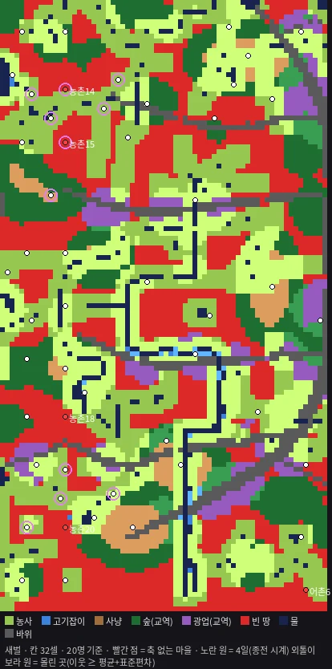
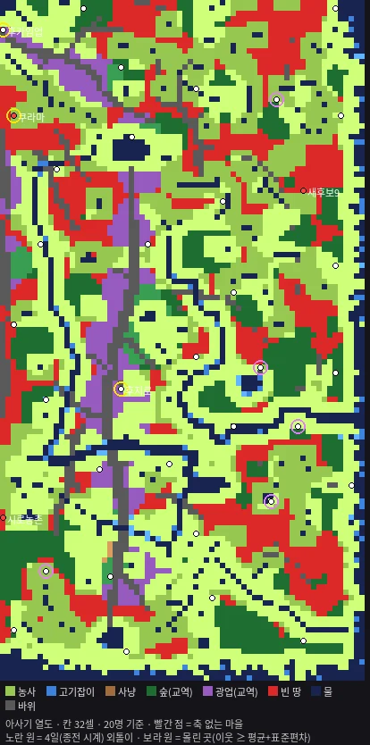

# T1153 보고 — 새벌 · 아사기 열도(닛폰) 지형 전수 조사: 빈 땅 · 마을 분포 균일도 · 고증 추가 후보 (세션4 · 2026-11-04)

**빈 땅 한반도 28.9% · 닛폰 18.6% · 4일 안 이웃 수 표준편차 3.07(한반도) · 1.27(닛폰)(종전 500 시계 — 몸 걸음 T474 로는 두 존 모두 전 마을이 4일 안이라 0) · 지류 · 숲 · 광맥을 빈 자리마다 넣으면 28.9% → 0.0%(지류만으로 0.03%) · 이미 있는 개울(T585)을 물로 세기만 해도 28.9% → 6.7% · 18.6% → 4.0%.**

- 빈 땅 = 걸어서 닿는 띠 안의 생업 다섯 축 중 어느 하나로도 마을 20명을 먹이거나 바꿔 먹이지 못하는 뭍 칸의 몫입니다(아래 §1 판정 식). 40명 기준이면 35.2% · 26.0% 입니다.
- 이 다섯 축 가운데 숲 · 광업은 **교역 값으로 바꿔 먹는다**고 본 것입니다. 먹거리 세 축(농사 · 고기잡이 · 사냥)만으로 자급하는 칸으로 좁히면 빈 땅은 **51.2% · 37.2%** 입니다.
- 베이스 = main `9da93350`(land1046 착지). 가지 `batch/terrain-census-1104` = main + 이 카드 한 커밋 **[승인 대기 · T1153]**.
- 제품 코드 0 · 판정 0 · 새 수 0. 계측기 둘(러너 밖 · 읽기만): `scripts/t1153-terrain-census.js`(표) · `scripts/t1153-draw.py`(그림).
- 그림: 맥 `~/Mini/산그림/T1153/` 여섯 장(존마다 생업 지도 · 빈 땅 처방 · 자리 규칙) — 레포엔 같은 그림을 `보고/T1153/` 에 webp 로 넣었습니다.

---

## §0 판 · 자

* 존 둘: 한반도(새벌 · 2,188 × 4,063셀 · 뭍 89.2%) · 닛폰(아사기 열도 · 2,187 × 4,063셀 · 뭍 83.7%).
* 지형 술어는 정본 그대로입니다 — `terrain` · 해안 띠(닛폰 · `generateCoastlineWaterTiles` · t436 그 줄) · 다리(존 설정 `bridges` — zone.js `BRIDGE_CELLS` 그 표) · 개울(`streams.isStreamCell`). 셀 래스터로 한 번 구워 셉니다(존당 30 ~ 55초).
* 격자 = 32셀마다 한 칸(4셀 표본 격자에 맞춘 중심) — 한반도 뭍 7,728칸 · 닛폰 7,239칸. 한 칸 = 그 자리에 마을이 선다면.
* 판 시간: 한반도 188초 · 닛폰 200초(한 판 1시간 안).

### 땅값 — 정본 식

| 칸 | 정본 | 이 판에서 |
|---|---|---|
| 숲 · 사냥 · 바위 · 광맥 몫 | `extractLandParamsApprox`(반경 140 · 4셀 표본 · 사냥 40 ~ 130 밴드) → `livelihood.landOf` | 같은 4셀 격자 · 같은 식 |
| 물 | 고리 스캔 `nearestWaterDist`(18방 · 140) → `max(0.05, 1 − nd/140) × 1.6` | 같은 고리 |
| 비옥도 | `fertility.buildField`(prepareFert 상자 62 · EDT) 를 실영토에서 평균 × 1.4 | 같은 상자 · 영토 = 원판(넓이 = 51 마을 실영토 중앙값 3,450칸) |
| 지속 상한 | `sustain.scanLabor` + `sustainOf`(노동권 150) | 그대로 |
| 광업 | `oreMix` 등급 · `specialOf` · 광종 칸(흑요석 · 옥 · 주석) | 그대로 |

**검증** — 후보 자리에서는 정본 그대로(실영토 `VillageLayout.generate` · 정본 술어)도 재서 맞댔습니다. 20명 판정이 같은 자리는 한반도 **50/51** · 닛폰 **47/50** 입니다(어긋난 넷은 원판과 실영토의 비옥도 차이로 문턱 근처에 걸린 자리).

### 축 판정 — econ 정본 조각만(손 문턱 0)

* 자리 = `jobCapacity`: s × 땅값 × 계수입니다(농부 s × 경작 몫 × 0.4 · 어부 s × 물 × 0.25 · 사냥 s × 사냥감 × 0.30 · 나무꾼 s × 숲 × 0.30 · 광부 s × 광업 × 0.30). s = 영토 ÷ 25 = 138 입니다.
* 1인 산출 = `JOBS` base × landBoost 입니다(1.5 · 1.2 · 0.7 · 0.9 · 1.5).
* 식량 등가: 곡 · 생선 · 고기는 1(`totalFoodEquivalent`)입니다. 나무 · 원석은 `BASE_VALUE` 비(1.67 · 1.0)로 바꿔 먹습니다(운송비 · 시장 깊이는 안 셈).
* 지속 상한 `woodSustain` · `fishSustain` 을 겁니다.
* **판정 = min(자리, N) × 1인 산출(상한까지) ≥ N × `DAILY_FOOD_CONSUMPTION`(1)** · N = 20 · 40.
* 상수는 econ 글자에서 읽었습니다(못 읽으면 멈춤).

 

---

## §1 생업 다섯 축 · 빈 땅 비율 (할 일 ① ②)

| 존 | 농사 | 사냥 | 숲(교역) | 고기잡이 | 광업(교역) | **빈 땅(20명)** | 빈 땅(40명) | 먹거리 세 축 빈 땅(20명) |
|---|---|---|---|---|---|---|---|---|
| 한반도 | 44.9% | 6.5% | 32.4% | 9.5% | 13.1% | **28.9%** | 35.2% | 51.2% |
| 닛폰 | 61.3% | 1.1% | 32.0% | 26.3% | 13.2% | **18.6%** | 26.0% | 37.2% |

(축 몫은 겹칩니다 — 한 칸이 둘 이상 축을 가질 수 있습니다.)

**지역별 빈 땅(20명)** — 존을 남북 넷 × 동서 둘로:

| 존 | 북서 | 북동 | 중북서 | 중북동 | 중남서 | 중남동 | 남서 | 남동 |
|---|---|---|---|---|---|---|---|---|
| 한반도 | 29.9% | 26.1% | 30.5% | 23.8% | 30.5% | 24.2% | **35.7%** | 29.3% |
| 닛폰 | 21.5% | **27.6%** | 19.6% | 18.0% | 12.2% | 13.7% | 11.7% | 23.6% |

* 한반도 빈 땅은 **서쪽 열**에 몰립니다(서 30 ~ 36% · 동 24 ~ 29%) — 배치 16 의 "서쪽 가장자리가 통째로 마른 땅" 그 판입니다.
* 닛폰은 북동이 가장 비고, 남쪽 절반이 가장 덜 빕니다. 북동은 재민이 직접 그리는 자리라 표에만 둡니다.
* 빈 땅의 꼴은 두 존 모두 같습니다: 비옥 0.42(물이 멀어 비옥도 바닥) · 물 0.08 ~ 0.9 · 숲 · 사냥 바닥 근처(0.45 ~ 0.63) · 광맥 없음.

### 지금 마을이 선 축 (20명)

* **한반도 51** — 농사 37 · 숲 19 · 고기잡이 8 · 광업 8 · 사냥 7.
  * 축 없음 5 = **농촌14 · 농촌15 · 농촌18 · 농촌20 · 어촌6** — 라이브의 해체 · 빈 마을 목록(농촌18 · 14 · 15 · 20)과 같은 자리입니다.
  * 축 하나뿐이고 그것이 교역 축인 자리: 농촌10(숲 20.4 — 문턱 20 에 걸림 · 라이브 해체) · 광산1 · 광산7(광업만) · 광산3 · 농촌9(숲만) — 라이브 "특산 있음 · 기근으로 못 씀" 넷이 여기 있습니다.
* **닛폰 후보 50 · 시딩 36**(존 설정 품질 게이트) — 농사 26 · 숲 13 · 고기잡이 9 · 광업 5 · 사냥 1.
  * 축 없음: 쿠라마 · 시로농촌 · 새후보9(시딩됨) · 아라광산(시딩 안 됨).
* 자리마다의 땅값 · 축 · 이웃 거리 전표: 부록 A.

그림: `{존}_1_생업지도.png`(레포 `보고/T1153/*.webp`) — 칸 색 = 그 칸을 먹이는 축(밝으면 둘 이상) · 빈 땅 빨강 · 빨간 점 = 축 없는 마을 · 노란 원 = 외톨이 · 보라 원 = 몰린 곳.

---

## §2 분포 균일도 (할 일 ③)

마을 사이 거리 = 교역 거리행렬(`_distMatrixGen`)과 같은 코스 격자 BFS입니다(4셀 · 8방 · 코너 절단 금지 · 다리 구제). 단위는 셀(1셀 = 1m)입니다.
4일 = ⓐ 몸 걸음(T474 켬 · `caravanWalkPerDay` 7,200 econ/일 = 2,880셀/일 → 11,520셀) · ⓑ 종전 시계(500 econ/일 = 200셀/일 → 800셀).

| 존 | 마을 | 가장 가까운 이웃 평균 · 표준편차 · 변동계수 | 범위 | 4일 이웃(ⓑ 종전) 평균 · **표준편차** · 변동계수 | 범위 | 4일 이웃(ⓐ 몸 걸음) | 외톨이(ⓑ 0) |
|---|---|---|---|---|---|---|---|
| 한반도 | 51 | 313.7 · 128.7 · 0.41 | 169 ~ 690 | 6.86 · **3.07** · 0.45 | 1 ~ 12 | 50(전부) | 0 |
| 닛폰 | 36 | 578.8 · 133.7 · 0.23 | 418 ~ 968 | 1.94 · **1.27** · 0.65 | 0 ~ 5 | 35(전부) | **3**(후지로 · 쿠라마 · 후카임업) |

* 몸 걸음(T474 · 지금 기본)으로는 두 존 모두 **모든 마을 쌍이 4일 안**입니다(존 대각선 ≈ 4,600셀 < 11,520셀). "4일 안 이웃 수"는 변별력이 없어서, 종전 시계(800셀)를 같이 적었습니다.
* 한반도는 **몰린 곳**이 서쪽 셋째 안(가로 800셀 안) 두 덩이입니다 — 북서(어촌4 · 9 · 15 · 16 · 농촌14 · 15 · 임업4 — 이웃 10 ~ 12) · 남서(어촌12 · 13 · 농촌11 · 19 — 이웃 10). 이웃이 가장 적은 곳은 광산4 · 광산7 · 어촌6(1)입니다.
* 닛폰은 이웃 거리가 한반도의 약 1.85배입니다(시딩 36 / 후보 50). 외톨이 셋 가운데 쿠라마는 축도 없습니다.
* 교역로 실길이(한반도 · 교역로 캐시 1,275쌍)도 계측 JSON 에 실었습니다(`routeCache.len`). 위 표는 거리행렬과 같은 코스 BFS 입니다.

---

## §3 고증 추가 후보 · 빈 땅이 몇 %로 주나 (할 일 ④)

재민 9월 순서 그대로입니다 — **① 지류(1 ~ 2셀 내천) → ② 자잘한 숲 → ③ 그러고도 남는 곳에 자잘 광맥**. 빈 자리마다 그것 하나를 그 자리 노동권 안에 넣고, 같은 정본 식으로 다시 판정했습니다(추정 — 실제 지도 편집은 다음 카드).

| 처방(빈 자리마다) | 한반도 빈 땅 | 닛폰 빈 땅 | 무엇으로 사나 |
|---|---|---|---|
| (지금) | 28.9% | 18.6% | — |
| **①′ 이미 있는 개울(T585 · 뭍의 0.9% · 0.65%)을 물로 센다** | **6.7%** | **4.0%** | 농사(비옥도 — 물거리) |
| ① 지류 하나 — 중심에서 20셀 · 폭 2셀 · 320셀 길이 | 0.03% | 0.01% | 농사(빈 자리 2,232곳 중 2,230) · 고기잡이(95) |
| ① 지류 40셀 | 0.03% | 0.01% | 농사 |
| ② 숲 하나 반경 62셀(배치 16 `sw4` 숲 1단계) — 중심에서 60셀 | 0.05% | 0.03% | 숲(교역) |
| ② 숲 반경 30셀 | 20.2% | 10.1% | 숲(교역) |
| ③ 자잘 광맥(광맥 몫 0.25% · `livelihood` '자잘' 등급) | 27.7% | 17.4% | 광업 — 거의 못 살림 |
| ①+② · ①+②+③ | 0.0% | 0.0% | — |

* **① 지류가 가장 큰 손잡이**입니다. 빈 땅의 병은 하나 — 물이 140셀 밖이라 비옥도가 바닥(0.42)인 것 — 이고, 지류가 20 ~ 40셀 안을 지나면 비옥도가 0.67 문턱을 넘어 농사로 섭니다.
* **①′ 는 새 지형이 아닙니다.** 개울(T585)은 이미 뭍의 0.9%(한반도) · 0.65%(닛폰)를 덮고 있습니다. 다만 지금 개울은 물 술어(`isWater` — 비옥도 물거리 · 물 땅값 · 어장)에 안 들어갑니다(villages.js 어댑터 주석 "개울은 통행이고 물도 아니다 · 낚시 0"). 개울을 비옥도 물거리에만 세는 것은 **판정 칸**입니다(회부 1).
* **② 숲**은 숲(교역) 축으로만 살립니다(먹거리 축 0). 교역 축은 이 판정에서 운송비 · 시장 깊이를 안 봅니다 — 농촌10 은 숲 20.4(문턱 20)로 통과 판정인데 라이브에서 해체됐습니다. 그래서 숲 처방은 "바꿔 먹을 길이 있을 때"의 상한입니다.
* **③ 자잘 광맥**은 혼자서는 거의 못 살립니다(빈 자리의 4% · 7%). 광부 정원이 s × 0.22 × 0.3 ≈ 9명이고, 원석 값이 식량과 1:1 이기 때문입니다. 9월 순서(③은 마지막)와 맞습니다.

### 고증 — 그 지형에 실제로 있었을 것(출처 한 줄씩)

| 추가 | 근거 | 출처 |
|---|---|---|
| 지류 · 소하천 | 유역 1,000km²당 지정하천 수 — 한강 35.4 · 일본 1급 수계 중앙값 36.3(29.2 ~ 60.5). 두 열도 모두 30대 중반 | `설계/고증_닛폰동쪽지리.md` §5-1 · §5-3 (T612 추신) |
| 하천 충적지 취락 | 청동기 취락 입지 = 하천 충적지 · 구릉 사면(비옥도 식의 근거 그 자체) | `server/fertility.js` 머리 주석 · `설계/고증_영토.md`(T543) |
| 취락 간격 | 송국리 "수 km 이내" 소규모 취락들 · 대평리 남강 유역 여러 지구 · 요시노가리 위성 취락 — 간격 1차 수치는 미확인 | `설계/고증_취락간격.md` ①(T616 계열) |
| 숲(참나무 · 소나무) | 마을 140셀 원 숲 몫 중앙 5.3% · 숲 0 마을 16/51 — 자리 고르기가 숲을 안 봄 · 송이=소나무 / 표고=활엽수 | `보고/T702_2026-10-12.md` · `설계/고증_군락.md` |
| 흑요석 · 옥 · 소금 · 목재(열도) | 고시다케 흑요석 · 이토이가와 옥 · 해안 소금 · 목재 — 야요이 자원 8 | `설계/고증_닛폰.md`(T551) |
| 한반도 특산(천하석 · 점판암 후보) | 품목 12 · 새 후보 2 | `설계/고증_한반도특산.md` |
| 다리 · 여울 | 한반도 출토 0 · 야요이 다리 기둥 후보 | `보고/T548_2026-09-30.md` · `설계/고증_다리.md` |

* 습지 · 갯벌 · 점토층은 이번 판 고증 문서에서 정량 근거를 찾지 못했습니다(미확인 — 추측으로 안 채웠습니다).
* 부록 A 의 "광업" 칸은 max(광맥 · 흑요석 · 옥 · 주석) 땅값입니다.
* 그림: `{존}_2_빈땅처방.png` — 빈 칸마다 순서대로 처음 살린 것(①′ 청록 · ① 파랑 · ② 초록 · ③ 보라 · 못 삶 빨강).

---

## §4 마을 자리 고르기 규칙 초안 (할 일 ⑤)

**초안(다음 초기화용 · 판정 0):**

1. 생업 하나 이상(20명 · §0 판정 식). 외톨이(4일 종전 시계 이웃 0)면 생업 둘 이상.
2. 같은 마을 수 · 가장 먼 점 고르기(곧은 간격을 이분해서 그 수가 나오는 가장 큰 간격).
3. 가장 가까운 이웃의 변동계수 ≤ 0.2 · 4일(종전) 이웃 수 표준편차 ≤ 지금의 절반.

**그 규칙으로 지금 지도에서 고르면** — 그림 `{존}_3_자리규칙.png`(흰 점 = 지금 · 노란 점 = 규칙):

| 존 | | 가장 가까운 이웃 평균 · 표준편차 · 변동계수 | 4일(종전) 이웃 평균 · 표준편차 | 외톨이 | 지금 자리와 64셀 안 겹침 |
|---|---|---|---|---|---|
| 한반도 51 | 지금 | 313.7 · 128.7 · **0.41** | 6.86 · **3.07** | 0 | — |
| | 규칙(간격 373셀) | 446.4 · 77.3 · **0.17** | 3.53 · **1.55** | 1(규칙17 · 축 셋) | 4 / 51 |
| 닛폰 36 | 지금 | 578.8 · 133.7 · 0.23 | 1.94 · 1.27 | 3 | — |
| | 규칙(간격 446셀) | 599.9 · 154.0 · 0.26 | 1.78 · 0.95 | 3(축 둘 이상) | 4 / 36 |

* 한반도는 규칙으로 고르면 이웃 거리 변동계수가 0.41 → 0.17 로, 이웃 수 표준편차가 3.07 → 1.55 로 줄어듭니다. 대신 자리가 거의 다 바뀝니다(겹침 4/51).
* 닛폰은 지금도 간격이 고르고(변동계수 0.23) 마을 수가 적어서 규칙이 거의 못 낫게 합니다. 균일도보다 **수**(36 → 50)와 외톨이 셋이 문제입니다.
* **최소 변경 판**(자리를 다 바꾸지 않고 축 없는 마을만 옮기기) — 가장 가까운 "생업 둘 이상" 칸까지:
  * 한반도: 농촌18 → 67셀(농사 · 고기잡이) · 농촌20 → 70셀(농사 · 고기잡이) · 농촌15 → 231셀(농사 · 숲) · 농촌14 → 245셀(농사 · 숲) · 어촌6 → 263셀(농사 · 숲).
  * 닛폰: 시로농촌 → 63셀(농사 · 고기잡이) · 새후보9 → 134셀(농사 · 숲) · 쿠라마 → 252셀(농사 · 광업).
  * 농촌18 · 20 · 시로농촌은 70셀 안에 물가 땅이 있어, 자리를 조금만 옮겨도 됩니다. 나머지는 ① 지류가 더 작은 손입니다(§3).

---

## §5 회부

1. **개울을 물로 셀까**(①′) — 개울 정본은 "건넌다 · 걸음 × 0.5 · 마신다 · 낚시 0"(재민 확정 · 족보 509 · 513)이고, 물 술어 밖입니다. 비옥도 물거리(충적 · 관개)에만 세면 빈 땅이 28.9 → 6.7%(한반도) · 18.6 → 4.0%(닛폰)로 줄고 낚시 0 은 그대로 둘 수 있습니다. 판정 칸입니다.
2. **교역 축의 무게** — 숲 · 광업을 `BASE_VALUE` 로 바꿔 먹는다고 본 다섯 축 판정은 운송비를 안 봅니다. 먹거리 세 축만이면 빈 땅은 51.2% · 37.2% 입니다. "자급 또는 특화"(재민 말)의 특화를 어느 값으로 셀지가 판정 칸입니다.
3. **닛폰 마을 수** — 후보 50 중 시딩 36(품질 게이트). 외톨이 3 · 이웃 거리 한반도의 1.85배입니다.
4. **영토 원판 근사** — 격자 칸의 비옥도는 실영토가 아닌 원판으로 쟀습니다. 후보 자리 검증은 50/51 · 47/50 입니다.
5. 습지 · 갯벌 · 점토층은 고증 수치가 없어 표에 못 올렸습니다(다음 고증 카드 후보).

* 산 계측: `계측/T1153_한반도_2026-11-04.json` · `계측/T1153_닛폰_2026-11-04.json`(격자 칸 전부 · 후보 자리 전표 · 거리행렬 · 처방 결과 · 규칙 자리).

---

## 부록 A — 자리 전표

### hanbando 새벌 — 후보 51 · 시딩 51
검증(정본 실영토 vs 래스터 원판 · 20명 축 같음): 50/51
| 마을 | 시딩 | 20명 축 | 40명 축 | 비옥 | 물 | 숲 | 사냥 | 광업 | 가장 가까운 이웃(셀) | 4일 이웃(종전) |
|---|---|---|---|---|---|---|---|---|---|---|
| 광산1 | ○ | 광업 | 광업 | 0.3 | 0.08 | 0.52 | 0.49 | 2.04 | 410 | 2 |
| 광산2 | ○ | 농사 · 광업 | 농사 · 광업 | 0.94 | 1.26 | 0.49 | 0.49 | 1.24 | 558 | 4 |
| 광산3 | ○ | 숲 | 없음 | 0.32 | 0.08 | 0.67 | 0.74 | 0.24 | 285 | 7 |
| 광산4 | ○ | 농사 · 고기잡이 · 광업 | 농사 · 광업 | 0.99 | 1.47 | 0.45 | 0.45 | 1.04 | 690 | 1 |
| 어촌1 | ○ | 농사 · 고기잡이 · 광업 | 농사 · 광업 | 0.96 | 1.47 | 0.45 | 0.45 | 1.19 | 514 | 4 |
| 광산5 | ○ | 숲 · 광업 | 숲 · 광업 | 0.46 | 0.46 | 1.15 | 1.25 | 0.81 | 217 | 5 |
| 광산6 | ○ | 농사 · 광업 | 농사 · 광업 | 0.9 | 1.07 | 0.45 | 0.45 | 1.07 | 291 | 9 |
| 광산7 | ○ | 광업 | 없음 | 0.3 | 0.61 | 0.53 | 0.53 | 0.70 | 487 | 1 |
| 어촌2 | ○ | 농사 · 사냥 · 숲 | 농사 · 사냥 · 숲 | 1.21 | 1.49 | 2.5 | 2.25 | 0.10 | 235 | 5 |
| 임업1 | ○ | 사냥 · 숲 · 광업 | 사냥 · 숲 · 광업 | 0.39 | 0.08 | 2.42 | 2.25 | 0.94 | 298 | 9 |
| 임업2 | ○ | 농사 · 사냥 · 숲 · 고기잡이 | 농사 · 사냥 · 숲 | 1.15 | 1.27 | 2.46 | 2.25 | 0.31 | 217 | 5 |
| 임업3 | ○ | 농사 · 사냥 · 숲 | 농사 · 사냥 · 숲 | 1 | 0.91 | 2.5 | 2.25 | 0.10 | 410 | 2 |
| 농촌1 | ○ | 농사 · 사냥 · 숲 | 농사 · 사냥 · 숲 | 0.85 | 0.69 | 2.5 | 2.22 | 0.10 | 299 | 7 |
| 임업4 | ○ | 사냥 · 숲 | 사냥 · 숲 | 0.53 | 0.08 | 1.68 | 1.48 | 0.10 | 404 | 10 |
| 임업5 | ○ | 사냥 · 숲 | 사냥 · 숲 | 0.39 | 0.83 | 1.36 | 1.5 | 0.05 | 285 | 8 |
| 어촌3 | ○ | 농사 · 숲 · 고기잡이 | 농사 · 고기잡이 | 1.09 | 1.47 | 0.72 | 0.65 | 0.10 | 664 | 2 |
| 임업6 | ○ | 농사 · 숲 | 농사 · 숲 | 1.13 | 1.31 | 1.47 | 1.26 | 0.10 | 235 | 6 |
| 농촌2 | ○ | 농사 · 숲 · 고기잡이 | 농사 · 숲 | 1.17 | 1.47 | 1.22 | 1.07 | 0.10 | 212 | 9 |
| 농촌3 | ○ | 농사 | 농사 | 1.11 | 1.46 | 0.47 | 0.45 | 0.10 | 390 | 2 |
| 어촌4 | ○ | 농사 | 농사 | 1.1 | 1.46 | 0.45 | 0.45 | 0.10 | 233 | 12 |
| 농촌4 | ○ | 농사 · 고기잡이 | 농사 · 고기잡이 | 1.1 | 1.47 | 0.45 | 0.45 | 0.10 | 169 | 9 |
| 농촌5 | ○ | 농사 | 농사 | 1.1 | 1.45 | 0.45 | 0.45 | 0.10 | 484 | 4 |
| 어촌5 | ○ | 농사 | 농사 | 1.11 | 1.47 | 0.56 | 0.52 | 0.10 | 274 | 8 |
| 어촌6 | ○ | **없음** | 없음 | 0.42 | 0.58 | 0.45 | 0.45 | 0.10 | 390 | 1 |
| 어촌7 | ○ | 농사 · 숲 | 농사 · 숲 | 1.1 | 1.46 | 0.88 | 0.78 | 0.10 | 260 | 6 |
| 어촌8 | ○ | 농사 | 농사 | 1.1 | 1.47 | 0.45 | 0.45 | 0.10 | 196 | 7 |
| 어촌9 | ○ | 농사 | 농사 | 1.11 | 1.49 | 0.48 | 0.46 | 0.10 | 233 | 11 |
| 어촌10 | ○ | 농사 | 농사 | 1.11 | 1.46 | 0.45 | 0.45 | 0.10 | 275 | 9 |
| 어촌11 | ○ | 농사 | 농사 | 1.09 | 1.47 | 0.45 | 0.45 | 0.13 | 630 | 2 |
| 어촌12 | ○ | 농사 · 숲 | 농사 | 1.12 | 1.47 | 0.77 | 0.69 | 0.10 | 212 | 10 |
| 어촌13 | ○ | 농사 | 농사 | 1.11 | 1.47 | 0.45 | 0.45 | 0.10 | 186 | 10 |
| 어촌14 | ○ | 농사 | 농사 | 1.11 | 1.47 | 0.55 | 0.5 | 0.42 | 300 | 5 |
| 어촌15 | ○ | 농사 | 농사 | 1.09 | 1.46 | 0.46 | 0.45 | 0.10 | 197 | 11 |
| 농촌6 | ○ | 농사 | 농사 | 0.88 | 0.97 | 0.59 | 0.52 | 0.10 | 335 | 7 |
| 어촌16 | ○ | 농사 | 농사 | 1.05 | 1.34 | 0.45 | 0.45 | 0.10 | 169 | 10 |
| 농촌7 | ○ | 농사 | 농사 | 0.99 | 1.03 | 0.46 | 0.45 | 0.10 | 300 | 8 |
| 농촌8 | ○ | 농사 | 농사 | 0.95 | 0.97 | 0.46 | 0.45 | 0.10 | 196 | 6 |
| 농촌9 | ○ | 숲 | 숲 | 0.44 | 0.08 | 1.03 | 0.91 | 0.10 | 284 | 7 |
| 농촌10 | ○ | 숲 | 없음 | 0.42 | 0.08 | 0.68 | 0.61 | 0.10 | 268 | 8 |
| 농촌11 | ○ | 농사 · 숲 | 농사 | 0.98 | 1.1 | 0.67 | 0.65 | 0.10 | 273 | 10 |
| 농촌12 | ○ | 농사 · 숲 | 농사 · 숲 | 0.94 | 0.8 | 0.91 | 0.73 | 0.10 | 270 | 5 |
| 농촌13 | ○ | 농사 · 숲 | 농사 | 0.82 | 0.83 | 0.78 | 0.72 | 0.10 | 355 | 9 |
| 농촌14 | ○ | **없음** | 없음 | 0.42 | 0.62 | 0.45 | 0.45 | 0.10 | 223 | 12 |
| 농촌15 | ○ | **없음** | 없음 | 0.42 | 0.08 | 0.63 | 0.63 | 0.10 | 197 | 11 |
| 농촌16 | ○ | 농사 | 농사 | 0.75 | 0.73 | 0.65 | 0.6 | 0.10 | 268 | 7 |
| 농촌17 | ○ | 농사 · 고기잡이 | 농사 | 1.1 | 1.39 | 0.45 | 0.45 | 0.10 | 274 | 9 |
| 농촌18 | ○ | **없음** | 없음 | 0.42 | 0.25 | 0.6 | 0.57 | 0.10 | 268 | 7 |
| 농촌19 | ○ | 농사 | 농사 | 0.93 | 1.07 | 0.45 | 0.45 | 0.10 | 202 | 10 |
| 농촌20 | ○ | **없음** | 없음 | 0.42 | 0.35 | 0.62 | 0.6 | 0.10 | 186 | 9 |
| 농촌21 | ○ | 농사 | 농사 | 0.92 | 1.02 | 0.56 | 0.53 | 0.10 | 270 | 8 |
| 농촌22 | ○ | 농사 · 고기잡이 | 농사 | 1.11 | 1.47 | 0.45 | 0.45 | 0.10 | 522 | 4 |
축별 시딩 마을 수(20명): {'농사': 37, '사냥': 7, '숲': 19, '고기잡이': 8, '광업': 8} 없음 5
규칙: 간격 373 자리 후보 5496 지금 자리 64셀 안 겹침 4 / 51 축 둘 이상 37 외톨이 [('규칙17', ['farm', 'fish', 'mine'])]

### nippon 아사기 열도 — 후보 50 · 시딩 36
검증(정본 실영토 vs 래스터 원판 · 20명 축 같음): 47/50
| 마을 | 시딩 | 20명 축 | 40명 축 | 비옥 | 물 | 숲 | 사냥 | 광업 | 가장 가까운 이웃(셀) | 4일 이웃(종전) |
|---|---|---|---|---|---|---|---|---|---|---|
| 이즈사키 | × | 농사 | 농사 | 1.12 | 1.49 | 0.64 | 0.63 | 0.10 | — | — |
| 지옹로 | × | 농사 | 농사 | 1.09 | 1.47 | 0.45 | 0.45 | 0.10 | — | — |
| 네코로 | ○ | 농사 · 숲 | 농사 · 숲 | 0.93 | 0.82 | 0.9 | 0.85 | 0.10 | 544 | 1 |
| 후지로 | ○ | 광업 | 광업 | 0.26 | 0.71 | 0.55 | 0.52 | 1.54 | 968 | 0 |
| 카토쿠 | ○ | 농사 · 고기잡이 · 광업 | 농사 · 고기잡이 · 광업 | 1.1 | 1.49 | 0.57 | 0.53 | 1.12 | 536 | 2 |
| 지옹다 | × | 농사 · 광업 | 농사 · 광업 | 0.74 | 0.75 | 0.51 | 0.57 | 2.50 | — | — |
| 노라마 | ○ | 농사 · 고기잡이 | 농사 | 1.09 | 1.46 | 0.54 | 0.51 | 0.10 | 533 | 1 |
| 후지다 | × | 농사 · 숲 | 농사 | 0.82 | 0.88 | 0.76 | 0.69 | 0.10 | — | — |
| 이즈이 | ○ | 농사 | 농사 | 1.12 | 1.49 | 0.59 | 0.56 | 0.10 | 666 | 1 |
| 쿠라마 | ○ | **없음** | 없음 | 0.42 | 0.81 | 0.45 | 0.45 | 0.10 | 822 | 0 |
| 지옹사키 | × | 광업 | 광업 | 0.27 | 0.08 | 0.45 | 0.45 | 2.34 | — | — |
| 마트노 | ○ | 사냥 · 숲 | 사냥 · 숲 | 0.53 | 0.74 | 1.77 | 1.51 | 0.10 | 474 | 1 |
| 쿠라다 | ○ | 숲 · 광업 | 숲 · 광업 | 0.27 | 0.41 | 0.94 | 0.89 | 2.20 | 464 | 2 |
| 히마쿠 | ○ | 농사 | 농사 | 0.88 | 1.03 | 0.61 | 0.57 | 0.10 | 504 | 3 |
| 타카쿠 | ○ | 농사 · 고기잡이 | 농사 | 0.93 | 1.39 | 0.45 | 0.45 | 0.10 | 682 | 1 |
| 타카노 | ○ | 농사 | 농사 | 0.98 | 1.12 | 0.6 | 0.55 | 0.10 | 528 | 1 |
| 아카어촌 | × | 농사 · 고기잡이 | 농사 · 고기잡이 | 1 | 1.07 | 0.63 | 0.63 | 0.10 | — | — |
| 시로농촌 | ○ | **없음** | 없음 | 0.42 | 0.87 | 0.45 | 0.45 | 0.10 | 418 | 2 |
| 쿠로어촌 | ○ | 농사 · 고기잡이 | 농사 · 고기잡이 | 1.1 | 1.49 | 0.58 | 0.53 | 0.10 | 431 | 3 |
| 아오어촌 | ○ | 농사 · 숲 | 농사 | 0.74 | 0.78 | 0.72 | 0.69 | 0.10 | 431 | 2 |
| 미도리광산 | ○ | 광업 | 없음 | 0.33 | 0.61 | 0.45 | 0.45 | 0.78 | 702 | 1 |
| 하야어촌 | ○ | 농사 | 농사 | 1.11 | 1.41 | 0.64 | 0.63 | 0.10 | 643 | 2 |
| 토오광산 | ○ | 농사 · 광업 | 농사 · 광업 | 0.82 | 0.57 | 0.59 | 0.59 | 1.00 | 601 | 2 |
| 사키농촌 | ○ | 농사 | 농사 | 0.77 | 0.89 | 0.54 | 0.51 | 0.19 | 533 | 2 |
| 후카임업 | ○ | 숲 | 숲 | 0.39 | 0.56 | 0.85 | 0.82 | 0.44 | 968 | 0 |
| 아라광산 | × | **없음** | 없음 | 0.29 | 0.08 | 0.57 | 0.54 | 0.54 | — | — |
| 키요어촌 | ○ | 농사 · 고기잡이 | 농사 · 고기잡이 | 1.08 | 1.28 | 0.45 | 0.45 | 0.10 | 622 | 2 |
| 나가임업 | ○ | 농사 | 농사 | 0.75 | 0.74 | 0.48 | 0.46 | 0.10 | 643 | 1 |
| 히로농촌 | ○ | 농사 · 고기잡이 | 농사 | 0.95 | 0.97 | 0.47 | 0.45 | 0.10 | 601 | 1 |
| 오오임업 | ○ | 숲 | 없음 | 0.42 | 0.58 | 0.78 | 0.77 | 0.54 | 474 | 2 |
| 새후보1 | × | 농사 · 고기잡이 | 농사 · 고기잡이 | 1.21 | 1.47 | 0.63 | 0.53 | 0.10 | — | — |
| 새후보2 | ○ | 농사 · 숲 · 고기잡이 | 농사 · 고기잡이 | 1.11 | 1.49 | 0.7 | 0.65 | 0.10 | 468 | 2 |
| 새후보3 | ○ | 농사 · 고기잡이 | 농사 | 0.79 | 0.85 | 0.68 | 0.65 | 0.10 | 522 | 2 |
| 새후보4 | ○ | 숲 | 숲 | 0.48 | 0.62 | 0.86 | 0.77 | 0.10 | 647 | 2 |
| 새후보5 | ○ | 농사 · 고기잡이 | 농사 · 고기잡이 | 1.12 | 1.38 | 0.49 | 0.46 | 0.10 | 676 | 1 |
| 새후보6 | ○ | 농사 · 숲 | 농사 · 숲 | 0.97 | 0.87 | 0.98 | 0.81 | 0.10 | 522 | 3 |
| 새후보7 | × | 농사 · 숲 · 고기잡이 | 농사 | 1.07 | 1.14 | 0.73 | 0.66 | 0.10 | — | — |
| 새후보8 | ○ | 농사 · 숲 | 농사 | 1.12 | 1.46 | 0.73 | 0.68 | 0.10 | 528 | 4 |
| 새후보9 | ○ | **없음** | 없음 | 0.42 | 0.81 | 0.63 | 0.6 | 0.10 | 522 | 3 |
| 새후보10 | ○ | 농사 | 농사 | 0.74 | 0.82 | 0.64 | 0.61 | 0.10 | 431 | 5 |
| 새후보11 | ○ | 농사 · 숲 | 농사 · 숲 | 0.77 | 0.65 | 1.28 | 1.12 | 0.10 | 462 | 4 |
| 새후보12 | ○ | 농사 | 농사 | 1.03 | 1.22 | 0.58 | 0.56 | 0.10 | 530 | 4 |
| 새후보13 | × | 농사 | 농사 | 0.8 | 0.82 | 0.53 | 0.53 | 0.10 | — | — |
| 새후보14 | × | 농사 · 숲 | 농사 · 숲 | 0.99 | 1.06 | 0.89 | 0.86 | 0.10 | — | — |
| 새후보15 | × | 농사 | 농사 | 0.82 | 0.83 | 0.57 | 0.55 | 0.10 | — | — |
| 새후보16 | ○ | 농사 · 숲 | 농사 | 1.08 | 1.36 | 0.76 | 0.7 | 0.10 | 664 | 1 |
| 새후보17 | ○ | 농사 · 숲 | 농사 · 숲 | 0.85 | 0.72 | 1.22 | 1.05 | 0.10 | 664 | 1 |
| 새후보18 | × | 농사 | 농사 | 0.8 | 0.87 | 0.49 | 0.47 | 0.10 | — | — |
| 새후보19 | × | 농사 · 고기잡이 | 농사 · 고기잡이 | 1.14 | 1.47 | 0.66 | 0.62 | 0.10 | — | — |
| 새후보21 | ○ | 농사 | 농사 | 1.08 | 1.35 | 0.45 | 0.45 | 0.10 | 418 | 5 |
축별 시딩 마을 수(20명): {'농사': 26, '사냥': 1, '숲': 13, '고기잡이': 9, '광업': 5} 없음 3
규칙: 간격 446 자리 후보 5891 지금 자리 64셀 안 겹침 4 / 36 축 둘 이상 33 외톨이 [('규칙4', ['farm', 'wood', 'fish', 'mine']), ('규칙19', ['farm', 'fish', 'mine']), ('규칙32', ['farm', 'fish'])]
