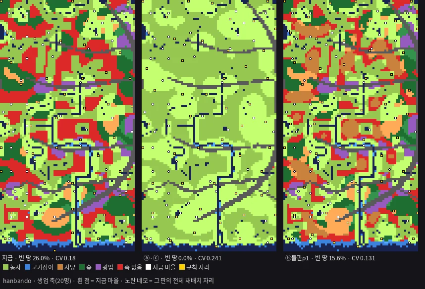

# T1178 보고 — 비옥도를 안 올리고 내륙을 살리는 길 둘: 밭작물 · 들판 (세션4 · 2026-11-05)

**밭작물 판 빈 땅 26.0% → 0.0%(닛폰 18.9% → 0.0%) · 들판 판 15.6%(닛폰 13.3%) · 둘 다 0.0%(0.0%) · 전체 재배치 자리 축 없음 0(0) · 변동계수 0.241(0.169)**

**한 줄 답:**

* 밭작물 판은 작물 표 그대로 유도하면 내륙이 모두 살아납니다. 대신 지역 차가 거의 사라집니다(내륙 ÷ 물가 비옥도 0.46 → 0.97). 판정 1 이 걱정한 평탄화가 생깁니다.
* 비옥도가 "물이 없을 때 얼마나 남는가"를 사다리로 재면 문턱이 0.2 와 0.3 사이에 있습니다. 바닥 0.3 이면 빈 땅 3.6% · 내륙 ÷ 물가 0.74 입니다.
* 들판 판은 들판을 숲과 같은 사냥터로 볼 때(ρ = 1)만 빈 땅이 줄어듭니다(26.0 → 15.6%). 절반(ρ = 0.5)이면 하나도 안 줄어듭니다.

- 베이스 = main `a2c1f2e3` + T1173 가지 커밋 하나(계측기 갈래 `--fert nosea` 를 그대로 씀 · 같은 글자) + 이 카드 한 커밋. 가지 `batch/dryland-1105` **[승인 대기 · T1178]**.
- 바탕 판 = 바다 뺌(11-04) · 개울 안 넣음(판정 1 ㄷ). T1173 ⓑ 와 같은 판입니다(빈 땅 26.0 · 18.9% 그대로).
- 제품 코드 0 · 새 수 0(사다리 값 0.2 · 0.3 · 0.4 와 ρ 는 판정용 눈금이고 제품 수가 아닙니다) · 판정 0 · 주사위 0 · force 0 · 배포 0.

---

## §1 고증 — 밭농사 (할 일 ①)

| 물음 | 찾은 것 | 출처 |
|---|---|---|
| 물가 아닌 곳의 밭 | 진주 평거동 — **경사면 밭**, 이랑이 등고선과 직교합니다. 진안 여의곡 — 밭고랑이 금강 흐름 · 등고선과 직교합니다. 그 밖 밭 유적은 진주 대평리(어은 1 · 옥방 1 · 2 · 4 · 6 · 8 · 9지구) · 논산 마전리입니다. | 우리역사넷 「청동기시대의 농경」 |
| 밭의 넓이 | 대평 중기 무문 밭 약 32,500㎡ | Wikipedia Mumun · Daepyeong |
| 작물(탄화 곡물) | 조 · 기장 · 콩 · 보리 · 밀 · 쌀이 나옵니다. 수수 · 피 · 율무도 함께 적혀 있습니다. 무문 사람들은 기장 · 조 · 보리 · 밀 · 콩류를 길렀고, 쌀은 "주된 작물이 아니었다"(전 · 중기)고 합니다. | 우리역사넷 · Wikipedia Mumun |
| 감정 주의 | 여주 흔암리(남한강가 구릉)는 처음 보고에서 쌀 · 겉보리 · 조 · 수수가 나왔다고 했습니다. 2014년 안승모 재검토는 조 · 수수를 잘못 감정한 것으로, 보리를 뒤 시기 혼입으로 보아 벼만 남깁니다. | itwiki 흔암리 유적 |
| 팥 | **미확인** — 위 출처에는 팥이 없습니다. 그래서 판의 작물 집합에서 뺐습니다. | — |
| 화전 | 전기 무문을 "이동 경작(shifting cultivation)"으로, 무문 토기를 쓴 사람들을 "화전 경작자(slash-and-burn cultivators)"로 적습니다. | Wikipedia Mumun |
| 야요이 밭 | 도쿠시마 쇼 · 구라모토(庄・蔵本) — 옛 물길 남안의 **완경사지(緩傾斜地)**에 이랑 있는 밭 약 200㎡가 있고, 조 · 기장이 나왔습니다. 북안 미고지에도 1,000㎡ 넘는 밭이 있습니다. 다만 둘 다 물길 곁이고, 구릉 위 밭은 그 출처에 없습니다. | 中村 豊(국립국어연 발표 요지) |
| 광맥 · 산지 흙이 밭에 좋은가 | **미확인** — 출처를 못 찾았습니다. | — |

* 정리: 경사면 밭은 있습니다(평거동 · 여의곡). 다만 출처의 밭은 모두 강 · 물길에서 멀지 않은 곳입니다. "물에서 멀리 떨어진 산자락 밭"을 직접 보여 주는 유적은 못 찾았습니다.

---

## §2 고증 — 들판 · 사냥감 · 가축 (할 일 ②)

| 물음 | 찾은 것 | 출처 |
|---|---|---|
| 트인 들판이 있었나 · 어디 | 대평 3-1-D 화분: 거주 기간 내내 오리나무(Alnus)가 이어지는 습한 조건 · 청동기부터 "개간 기미"가 보입니다. 강경천 하류: 청동기는 "여전히 늪 조건 우세". 홀로세 식생사: 재배 벼 화분 · 비수목 화분이 숲 벌채 증가를 가리킵니다. 다만 소나무가 우세해지는 것은 2,000 ~ 1,500년 전입니다. | Moon 외 2018(The Holocene) · 문영롱 · 이정범 · 「홀로세 중 한국의 식생사」(1994) |
| → 들판 자리 | 출처가 가리키는 트인 땅은 **범람원 습지 · 개간지 · 화전 자리**입니다. 곧 대개 물가입니다. **내륙의 빈 땅이 초원이었다는 출처는 못 찾았습니다(미확인).** | 위 셋 |
| 사냥감 밀도 | 고라니 — 저지 **6.93** · 산지 **1.91** · 도시 1.27 마리/㎢(현대). 서식지는 강가 갈대밭 · 늪 · 초지 · 경작지입니다. 멧돼지 — 전국 **1.1** 마리/㎢(2022 · 돼지열병 뒤 · 서식지 구분 없음). 노루 — **미확인**. | 이화여대 고라니 논문 · Wikipedia Water deer · 국립생물자원관 2022(이투데이) |
| 소 · 말 | 『삼국지』 동이전 마한조 국역: "소나 말을 탈 줄 모르기 때문에 소나 말은 모두 장례용으로 써버린다." **한문 원문 대조는 못 했습니다**(원문 쪽을 못 열었습니다). | 전북일보 최완규 「마한 이야기」 |
| 돼지 | 야요이 — 마쓰에 니시카와즈(西川津) 아래턱 93점 중 판별 26점의 22점이 사육 형질입니다. 탄소 · 질소 동위원소에서 사람이 준 먹이가 1점, 야생 먹이가 2점입니다. 그래서 "사육 돼지와 멧돼지 사냥이 같이 있었다"고 봅니다(2026-06). 한반도 — 백제 풍납토성에서 집돼지 가능성이 보이고, 집돼지와 멧돼지 구별은 "아직 열린 문제"입니다. 청동기 돼지 사육은 **미확인**입니다. | 나고야대 보도 자료 2026-06-24 · 최현구 외 2016 |
| 개 | 보령 고남리 청동기 — 사람뼈와 개 1개체가 모두 C4 식물(조 · 기장 계열)을 주로 먹었습니다. 사람 곁에서 먹은 개로 읽힙니다. | 최현구 외 2016(비교표 인용) |
| 닭 | 마한 "꼬리 가는 닭(細尾雞)" — **원문 미확인**(원문 쪽을 못 열었습니다). | — |

* 정리: 목축(소 · 양 떼)은 근거가 없습니다(마한도 소 · 말을 타지 않고 장례에 씀). 그래서 판은 PM 주대로 **사냥 축**으로 쟀습니다. 돼지 · 개는 가축 카드 감입니다.

---

## §3 ⓐ 밭작물 판 (할 일 ③-ⓐ)

### 유도(새 수 0)

* **물 공급 눈금** = zone.js `WATER_SUPPLY_STEPS` `[[1,5],[3,4],[6,3],[9,2]]`, 그 밖은 1입니다. 계측기가 글자에서 읽습니다(사본 0).
* **물충족** = crops.js `waterMult(작물, 공급)` 정본입니다. 모자란 만큼 × 관리난이도 ÷ 5 만큼 깎입니다.
* **수확 비** r = `수확량 × kcal`(작물 표) ÷ 집합에서 가장 큰 값(쌀 9 × 3,500)입니다. 식량 단위가 열량이기 때문입니다(족보 · kcal 캐논).
* 칸의 물 항 g = max(정본 항 e^(−물거리/80), 작물마다 r × waterMult(공급(물거리))). 그다음 `fertility.fertAt` 정본 식에 넣습니다. **정본보다 작아지는 칸은 없습니다.**
* 작물 집합 = §1 출처에 있는 것: 쌀 · 조 · 기장 · 보리 · 밀 · 콩.

| 작물 | 물요구 · 관리 | r | 물 없는 땅(공급 1)의 r × waterMult |
|---|---|---|---|
| 쌀 | 5 · 5 | 1.000 | 0.200 |
| 보리 | 2 · 2 | 0.756 | **0.605** |
| 밀 | 2 · 2 | 0.733 | 0.587 |
| 조 | 1 · 2 | 0.571 | 0.571 |
| 콩 | 2 · 2 | 0.635 | 0.508 |
| 기장 | 1 · 1 | 0.457 | 0.457 |

→ 물에서 9셀 넘게 떨어진 칸은 모두 공급 1 이라, 물 항이 보리 0.605(월동 보리 · 밀을 빼면 조 0.571)로 바닥을 깝니다. 정본 항은 80셀에서 0.37, 200셀에서 0.08 입니다.

### 결과

| 존 | 판 | 빈 땅 20명 | 40명 | 먹거리 세 축 빈 땅 | 농사 칸 | 비옥도 중앙 · 편차 | 물가(≤80셀) | 내륙 | 내륙 ÷ 물가 |
|---|---|---|---|---|---|---|---|---|---|
| 한반도 | 지금(바다 뺌) | 26.0% | 32.5% | 48.8% | 45.6% | 0.52 · 0.267 | 0.92 | 0.42 | 0.46 |
| | **ⓐ 밭작물** | **0.0%** | 0.4% | 0.0% | 99.2% | 0.94 · 0.081 | 0.97 | 0.94 | **0.97** |
| | ⓐ′ 월동(보리 · 밀) 뺌 | 0.0% | 0.4% | 0.0% | 99.2% | 0.92 · 0.083 | 0.95 | 0.92 | 0.97 |
| 닛폰 | 지금(바다 뺌) | 18.9% | 27.6% | 37.9% | 55.2% | 0.76 · 0.269 | 0.88 | 0.42 | 0.48 |
| | **ⓐ 밭작물** | **0.0%** | 1.1% | 0.1% | 98.1% | 0.94 · 0.100 | 0.96 | 0.94 | **0.98** |
| | ⓐ′ 월동 뺌 | 0.0% | 1.2% | 0.1% | 97.9% | 0.92 · 0.101 | 0.94 | 0.92 | 0.98 |

* **평탄화가 생깁니다.** 비옥도 편차가 0.267 → 0.081(한반도)로 줄고, 물가와 내륙이 거의 같아집니다(0.97). 농사 칸이 45.6 → 99.2% 가 됩니다.
* 이유: 정본의 물 항(0.62)이 비옥도에서 가장 크고, 밭작물은 그 항을 거의 다 가져갑니다. 정본 항은 충적 흙과 물을 한 항으로 묶습니다. 물이 덜 드는 작물이 "물 몫"만 덜 받아야 하는지, "흙 몫"도 같이 받아야 하는지를 가를 출처가 없습니다(§1 미확인).
* 축이 바뀌는 마을(ⓐ · 한반도 13 / 닛폰 12): 축 없던 마을이 모두 농사를 얻습니다(한반도 농촌14 · 15 · 18 · 20 · 닛폰 쿠라마 · 시로농촌 · 후카임업 · 새후보9). 광산 · 임업 마을도 농사 축이 더해집니다(광산1 0.29 → 0.82 등). 전표는 `계측/T1178_갈래표_2026-11-05.json` 에 있습니다.

### 사다리 — 물 항 바닥이 얼마면 어떻게 되나(판정용 · 작물 표 유도값 아님)

| 바닥 g | 한반도 빈 땅 | 내륙 ÷ 물가 | 닛폰 빈 땅 | 내륙 ÷ 물가 |
|---|---|---|---|---|
| 0(지금) | 26.0% | 0.46 | 18.9% | 0.48 |
| 0.2 | 25.7% | 0.64 | 18.5% | 0.67 |
| **0.3** | **3.6%** | 0.74 | **7.4%** | 0.77 |
| 0.4 | 2.0% | 0.84 | 4.2% | 0.87 |
| 0.605(ⓐ 보리) | 0.0% | 0.97 | 0.0% | 0.98 |

* 문턱은 0.2 와 0.3 사이입니다. 농사 축은 마을 비옥도 ≥ 하루 소비 ÷ 1인 산출(1 ÷ 1.5 = 0.667)이면 서고, 그 경계가 이 구간에 걸립니다.
* 바닥 0.3 이면 빈 땅은 거의 닫히고, 물가가 여전히 내륙보다 4분의 1쯤 낫습니다. 작물 표 그대로의 0.605 는 그 두 배입니다.

---

## §4 ⓑ 들판 판 (할 일 ③-ⓑ)

* **식:**
  * 1차 판에서 축 없는 격자 칸의 32 × 32셀 덩이 중, 뭍이면서 숲 · 바위가 아닌 셀을 들판으로 둡니다.
  * 2차 판은 같은 판정입니다. 사냥 밴드(40 ~ 130셀) 몫 = (숲 셀 + ρ × 들판 셀) ÷ 밴드 셀입니다.
  * 사냥감 = `livelihood.landOf` 정본(0.45 + 1.8 × 밴드 몫)입니다.
* **ρ:**
  * 서식지가 갈린 밀도 출처는 고라니 하나입니다(저지 6.93 ≥ 산지 1.91). 그래서 "들판은 숲만 못하다"는 근거는 없습니다. ρ = 1(들판 = 숲과 같은 사냥터)을 위쪽 판으로, ρ = 0.5 를 견줌 판으로 잽니다.
  * 노루 · 멧돼지의 서식지별 밀도는 미확인이라 출처로 ρ 를 한 값으로 못 박지 못합니다.

| 존 | 판 | 빈 땅 20명 | 40명 | 사냥 칸 | 들판 셀 |
|---|---|---|---|---|---|
| 한반도 | 지금 | 26.0% | 32.5% | 6.7% | — |
| | **ⓑ ρ = 1** | **15.6%** | 20.9% | 21.6% | 1,907,031 |
| | ⓑ′ ρ = 0.5 | 26.0% | 32.5% | 6.8% | 같음 |
| 닛폰 | 지금 | 18.9% | 27.6% | 1.1% | — |
| | **ⓑ ρ = 1** | **13.3%** | 21.8% | 7.6% | 1,275,838 |
| | ⓑ′ ρ = 0.5 | 18.9% | 27.6% | 1.1% | 같음 |

* 사냥 축 문턱: 사냥감 ≥ 20 × 1 ÷ (20 × 0.7) = 1.43, 곧 밴드 몫 ≥ 0.54 입니다. ρ = 0.5 는 밴드가 모두 들판이어도 0.5 라 못 넘습니다. **ρ 문턱 ≈ 0.54** 입니다.
* 한반도 ρ = 1 — 축 없던 넷(농촌14 · 15 · 18 · 20)이 사냥으로 삽니다. 숲 마을 넷도 사냥 축이 붙습니다(광산3 · 임업6 · 농촌10 · 11).
* 닛폰 ρ = 1 — 축 없는 넷(쿠라마 · 시로농촌 · 후카임업 · 새후보9)은 그대로 축이 없습니다. 사냥감이 0.51 ~ 1.36 이라 문턱 1.43 아래입니다. 밴드에 물 · 바위 · 지금 생업 있는 칸이 섞여 들판 몫이 모자랍니다.
* **고증과 어긋남:** 출처의 트인 땅은 범람원 · 습지 · 개간지(물가)입니다. 판의 들판은 내륙 빈 땅입니다. 내륙 빈 땅이 들판이었다는 출처는 없습니다(§2).

---

## §5 ⓒ 둘 다 · 땅에 맞춰 고른 작물 (할 일 ③-ⓒ)

* ⓒ = ⓐ + 들판 ρ = 1. ⓐ 에서 이미 빈 칸이 0 이라 들판이 생길 자리가 없습니다. 그래서 **ⓒ 는 ⓐ 와 같습니다**(한반도 0.0% · 닛폰 0.0%).
* 작물 고르기: 칸마다 위 g 를 가장 크게 주는 작물입니다. 마을 영토(원판)에서 가장 많이 고른 작물로 셉니다.

| 존 | 판 | 논(정본 물 항 · 쌀) 마을 | 밭 마을 |
|---|---|---|---|
| 한반도 51 | ⓐ | 25 | 보리 26 |
| | ⓐ′ 월동 뺌 | 25 | 조 26 |
| 닛폰 36 | ⓐ | 11 | 보리 25 |
| | ⓐ′ 월동 뺌 | 13 | 조 23 |

* 물가 마을(어촌 대부분 · 농촌2 ~ 5 · 22 · 카토쿠 · 이즈이 등)은 영토의 92 ~ 97%가 논입니다. 광산 · 임업 · 내륙 농촌(광산1 · 3 · 5 · 7 · 임업1 · 4 · 5 · 농촌9 · 10 · 14 ~ 16 · 18 · 20 · 후지로 · 쿠라마 · 시로농촌 · 새후보2 ~ 5 · 9 등)은 100% 밭(보리 또는 조)입니다. 가운데 마을(광산2 · 6 · 임업2 · 3 · 6 · 농촌6 ~ 8 · 11 · 19 · 21 · 히마쿠 · 타카노 등)은 논과 밭이 섞입니다.
* 마을별 비율 전표는 `계측/T1178_갈래표_2026-11-05.json` → `<존>.a1.crop` · `a2.crop` 에 있습니다.
* 지금 생활 층은 마을 번호 해시로 작물을 고릅니다(`_villageCropFor` · 땅 무관). 이 표는 그것을 땅으로 고르면 어떻게 되는지입니다. 제품은 그대로입니다.

---

## §6 자리 규칙 다시 — 전체 재배치 (할 일 ④)

T1153 §4 규칙(생업 하나 이상 · 같은 수 · 가장 먼 점)을 판마다 다섯 축으로 다시 돌렸습니다. 외톨이 = 4일(종전 시계) 이웃 0.

| 존 | 판 | 간격(셀) | 이웃 거리 평균 · 편차 · **변동계수** | 4일 이웃 평균 · 편차 | 외톨이(축 수) | 축 하나 | **축 없음** | 지금 자리와 64셀 안 겹침 |
|---|---|---|---|---|---|---|---|---|
| 한반도 51 | 지금 자리 | — | 313.7 · 128.7 · 0.41 | 6.86 · 3.07 | 0 | — | 4 | — |
| | 규칙 · 바다 뺌 | 384 | 463.6 · 83.3 · **0.18** | 3.45 · 1.68 | 2(3 · **1**) | 15 | 0 | 6 |
| | 규칙 · ⓐ · ⓒ | 375 | 471.5 · 113.4 · **0.241** | 3.45 · 1.73 | 4(3 · 3 · 3 · 2) | 5 | **0** | 5 |
| | 규칙 · ⓑ ρ = 1 | 375 | 454.0 · 59.6 · **0.131** | 3.61 · 1.78 | 1(3) | 8 | 0 | 6 |
| | 규칙 · 바닥 0.3 | 373 | 470.0 · 110.1 · 0.234 | 3.41 · 1.72 | 4(3 · 3 · 2 · 2) | 6 | 0 | 5 |
| 닛폰 36 | 지금 자리 | — | 578.8 · 133.7 · 0.23 | 1.94 · 1.27 | 3 | — | 4 | — |
| | 규칙 · 바다 뺌 | 431 | 586.6 · 149.0 · 0.254 | 2.22 · 1.18 | 2(4 · 3) | 5 | 0 | 2 |
| | 규칙 · ⓐ · ⓒ | 458 | 554.1 · 93.5 · **0.169** | 2.33 · 1.41 | 2(4 · 3) | 3 | **0** | 5 |
| | 규칙 · ⓑ ρ = 1 | 435 | 588.1 · 144.3 · 0.245 | 2.06 · 0.91 | 2(4 · 3) | 3 | 0 | 3 |
| | 규칙 · 바닥 0.3 | 458 | 562.9 · 85.2 · **0.151** | 2.22 · 1.13 | 1(4) | 4 | 0 | 5 |

* **축 없는 자리 0** — 모든 판이 0 입니다(규칙이 생업 있는 칸만 고릅니다).
* **변동계수 ≤ 0.2** — 한반도는 바다 뺌(0.18)과 들판(0.131)이 맞추고, 밭작물(0.241)은 못 맞춥니다. 닛폰은 밭작물(0.169)과 바닥 0.3(0.151)이 맞추고, 바다 뺌(0.254)과 들판(0.245)은 못 맞춥니다.
* 밭작물 판에서 한반도 변동계수가 오르는 이유: 고를 칸이 거의 모든 뭍으로 늘어, 점수(축 수) 순 가장 먼 점 고르기가 간격을 덜 고르게 놓습니다. 규칙 ③(변동계수)은 확인 조건이지 고르는 산수에 안 들어 있습니다.
* 규칙 ①의 둘째(외톨이면 생업 둘 이상)는 한반도 바다 뺌 판에서 한 자리(규칙50 · 축 하나)가 어깁니다. 다른 판은 모두 지킵니다.
* 지금 자리와 겹침은 2 ~ 6 입니다. 전체 재배치는 자리가 거의 다 바뀝니다(T1153 과 같음).

그림:

* `보고/T1178/{존}_생업_자리.webp` — 지금 · ⓐ · ⓒ · ⓑ ρ1, 흰 점 = 지금 마을, 노란 네모 = 그 판의 재배치 자리.
* `{존}_비옥도_전후.webp` — 지금 → ⓐ → 바닥 0.3.
* `{존}_작물.webp` — ⓐ · ⓐ′.
* 맥에는 `~/Mini/산그림/T1178/` 에 PNG 로 있습니다.

---

## §7 회부(판정 칸)

1. **밭작물의 물 항 바닥** — 작물 표 그대로(보리 0.605 · 조 0.571)면 평탄화가 생깁니다(내륙 ÷ 물가 0.97). 바닥 0.3 이면 빈 땅 3.6 · 7.4%, 지역 차 0.74 · 0.77 이 남습니다. 정본 물 항을 물 몫과 흙 몫으로 가를지, 바닥을 어디에 둘지는 판정 칸입니다(출처 미확인).
2. **월동 작물(보리 · 밀)을 바닥에 셀지** — 빼도(ⓐ′ 조) 결과는 거의 같습니다(0.571 · 빈 땅 0%).
3. **들판 ρ** — 문턱이 약 0.54 입니다. 출처는 고라니 하나뿐이고, 들판 자리는 고증상 물가(범람원 · 습지)입니다. 내륙 빈 땅을 들판으로 삼는 것은 고증 밖입니다.
4. **자리 규칙 ③ 변동계수** — 확인 조건만으로는 밭작물 판 한반도가 0.241 로 넘칩니다. 고르는 산수에 넣을지(예: 간격 이분 뒤 이웃 거리 고르기) 판정 칸입니다.
5. **가축 카드** — 개(고남리 · 조 · 기장을 먹은 개)는 근거가 있습니다. 돼지는 야요이는 있고 한반도 청동기는 미확인입니다. 소 · 말은 마한 국역상 장례용입니다. 닭 · 마한 한문 원문은 미확인입니다.

* 산 계측: `계측/T1178_갈래표_2026-11-05.json`(판 아홉 × 두 존 · 마을 축 · 작물 비율 · 규칙 자리 통계).
* 계측기: `scripts/t1153-terrain-census.js` 에 `--crop wy|w|floor:g` · `--crops` · `--field ρ` 를 더했습니다(기본값은 종전 글자 그대로). 그림: `scripts/t1178-draw.py`.

## 출처

* 우리역사넷 「청동기시대의 농경」 — https://contents.history.go.kr/mobile/km/view.do?levelId=km_027_0030_0010_0020
* Wikipedia, Mumun pottery period — https://en.wikipedia.org/wiki/Mumun_pottery_period
* Wikipedia, Daepyeong — https://en.wikipedia.org/wiki/Daepyeong
* itwiki, 여주 흔암리 유적 — https://itwiki.kr/w/%EC%97%AC%EC%A3%BC_%ED%9D%94%EC%95%94%EB%A6%AC_%EC%9C%A0%EC%A0%81
* 中村 豊, 庄・蔵本遺跡 발표 요지(국립국어연구소) — https://www2.ninjal.ac.jp/past-projects/languagedispersal/abs_Nakamura.pdf
* Moon · Lee · Lee 2018, Daepyeongri 3-1-D (The Holocene 28(12)) — https://scholar.korea.ac.kr/handle/2021.sw.korea/71400
* 문영롱 · 이정범, 강경천 하류 화분분석 — https://m.earticle.net/Article/A183866
* 「홀로세 중 한국의 식생사」(1994) — https://koreascience.kr/article/JAKO199411920412834.page?lang=en
* 이화여대, Korean water deer distribution · density · habitat use — https://pure.ewha.ac.kr/en/publications/distribution-density-and-habitat-use-of-the-korean-water-deer-hyd/
* Wikipedia, Water deer — https://en.wikipedia.org/wiki/Water_deer
* 이투데이(국립생물자원관 2022 멧돼지 밀도) — https://www.etoday.co.kr/news/view/2243547
* 전북일보 최완규 「마한의 장제문화」 — https://www.jjan.kr/articleAmp/20210202725806
* 최현구 외 2016, 풍납토성 동물뼈 동위원소 — https://koreascience.or.kr/article/JAKO201620340444890.pdf
* 나고야대 보도 자료 2026-06-24(야요이 돼지) — https://www.nagoya-u.ac.jp/researchinfo/result/upload_images/20260624_num.pdf
